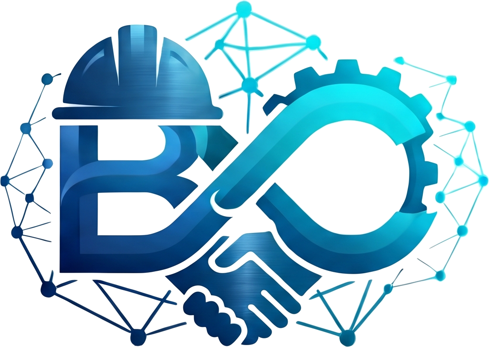

# BluKaam Connection (ब्लूकाम कनेक्शन)

<div align="center">
  
  <h3>The Professional Network Built for India's Blue-Collar Workforce</h3>
  <p><em>Apni Skill Dikhao, Sahi Job Pao · Contractors ko Skilled Workers Milen · Workers ko Sahi Kaam Milen</em></p>

  [](https://nodejs.org/)
  [](https://expressjs.com/)
  [](https://www.mongodb.com/)
  [](LICENSE)
</div>

---

## 📖 Overview

**BluKaam Connection** is a digital platform and professional network tailored specifically for electricians, plumbers, carpenters, masons, painters, welders, and skilled contractors across India. It bridges the gap between skilled workers seeking steady, well-paying employment and contractors/homeowners who need verified talent.

- **Live Render Web Service:** [https://blukaam-connection.onrender.com](https://blukaam-connection.onrender.com)
- **GitHub Pages:** [https://hink001.github.io/blukaam-connection/](https://hink001.github.io/blukaam-connection/)

---

## ✨ Key Features

- **🔐 Dual Authentication System:**
  - One-tap **Google Sign-In** with secure OAuth 2.0 popup communication (COOP-compliant).
  - 100% Free **Email OTP Verification** with automated SMTP delivery and local dev simulation fallback.
  - JWT session token generation with role-based access control (`worker` vs `contractor`).

- **👤 LinkedIn-Style Blue-Collar Profiles:**
  - Skill badges, experience tracking, certifications, and portfolio photo uploads.
  - Public directory with search filters by city and trade.

- **💼 Job Marketplace:**
  - Job board allowing contractors to post requirements and workers to apply directly.

- **🤝 Networking & Community Feed:**
  - Interactive social feed for site photos, job announcements, and industry updates.
  - Connection requests, direct messaging, and real-time notifications.

- **💾 Dual Database Engine (Online & Offline):**
  - High-performance cloud persistence with **MongoDB Atlas**.
  - Automatic zero-config offline fallback using a local JSON database when disconnected.

---

## 🛠️ Tech Stack

- **Frontend:** Semantic HTML5, Vanilla CSS3 (Custom Design System, Glassmorphism, Micro-animations), Vanilla JavaScript (ES6 Modules)
- **Backend:** Node.js, Express.js
- **Database:** MongoDB Atlas (Mongoose ODM) + Local JSON fallback
- **File & Media Storage:** Cloudinary CDN + Base64 fallback
- **Authentication:** JWT, Google Identity Services, Nodemailer (Email OTP)
- **Security:** Helmet, CORS, Express Rate Limit, Input Sanitization

---

## 🚀 Getting Started

### Prerequisites

- [Node.js](https://nodejs.org/) (v18 or higher)
- [npm](https://www.npmjs.com/)

### Installation

1. **Clone the repository:**
   ```bash
   git clone https://github.com/hink001/blukaam-connection.git
   cd blukaam-connection
   ```

2. **Install dependencies:**
   ```bash
   npm install
   ```

3. **Configure Environment Variables:**
   Copy `.env.example` or update your `.env` file with your credentials:
   ```env
   PORT=3000
   MONGO_URI=your_mongodb_connection_string
   JWT_SECRET=your_jwt_secret
   SMTP_HOST=smtp.gmail.com
   SMTP_PORT=586
   SMTP_USER=your_email@gmail.com
   SMTP_PASS=your_email_app_password
   CLOUDINARY_CLOUD_NAME=your_cloudinary_name
   CLOUDINARY_API_KEY=your_cloudinary_key
   CLOUDINARY_API_SECRET=your_cloudinary_secret
   ```

4. **Start the server:**
   ```bash
   node server.js
   ```
   Open [http://localhost:3000](http://localhost:3000) in your browser.

---

## 📂 Project Architecture

```
├── .env                  # Environment configuration
├── .nojekyll             # Ensures GitHub Pages serves all static files
├── index.html            # Landing page
├── login.html            # Authentication & OTP verification
├── dashboard.html        # Worker & contractor dashboard
├── feed.html             # Community feed & updates
├── network.html          # Networking & connection management
├── messages.html         # Direct messaging
├── notifications.html    # Notification alerts
├── jobs.html             # Job search and listings
├── workers.html          # Directory of skilled workers
├── training.html         # Upskilling & PMKVY courses
├── profile.html          # Worker profile view
├── style.css             # Core design system & utilities
├── social.css            # Community feed and messaging styles
├── script.js             # General UI interactivity
├── auth-profile.js       # Auth, Google Sign-In & profile client SDK
├── social-sdk.js         # Social feed, messaging & network client SDK
├── server.js             # Root server launcher
└── bluekamm/             # Express backend
    ├── server.js         # Express app, static serving & API endpoints
    ├── db.js             # MongoDB Atlas connection handler
    ├── models/           # Mongoose schemas (User, Profile, Post, Message, etc.)
    ├── routes/           # REST API routes (Auth, Profile, Social, Jobs, etc.)
    ├── middleware/       # Rate limiting, auth, security & uploads
    └── services/         # Email, Cloudinary & Notification handlers
```

---

## 📄 License

This project is licensed under the MIT License.
